# Your first hour with the app

This page starts where [SETUP.md](SETUP.md) ends: your app is online and you can open the coach
console. It walks through the first client from start to finish: add them, give them a program,
get their health screen, let them in, and see their first check-in.

Plan for about 30 minutes of your own time. Some steps wait on the client (the health screen and
signing in). Every screen below is from a test copy of the app with made-up people
("Sample Client") and the [sample programs](starter-content/README.md).

The coach console is built for a phone. It works the same in a computer's browser.

What you will do:

1. [Put a program in the app](#1-put-a-program-in-the-app) (5 minutes)
2. [Add your first client](#2-add-your-first-client) (2 minutes)
3. [Send the health screen](#3-send-the-health-screen) (2 minutes, then the client takes about 2)
4. [Assign a program](#4-assign-a-program) (1 minute)
5. [Decide on nutrition](#5-decide-on-nutrition) (1 to 10 minutes)
6. [Release and invite](#6-release-and-invite) (3 minutes)
7. [What the client sees](#7-what-the-client-sees)
8. [Check-ins and replies](#8-check-ins-and-replies)

---

## 1. Put a program in the app

You need at least one program before a client can train. Pick one way:

- **Load the samples.** Follow [starter-content/README.md](starter-content/README.md): copy
  `sample_programs.sql` into the Supabase SQL Editor (the same place as SETUP.md step 9) and click
  **Run**. Three programs whose names start with `Sample:` appear. They are sample content: edit
  them before you use them with a real client.
- **Build your own.** Tap **More** (bottom right), then **Programs**, then **New program**. Name
  it, add training and rest days, add exercises with sets and reps, and tap **Save**.

Either way, the list is under **More > Programs**:

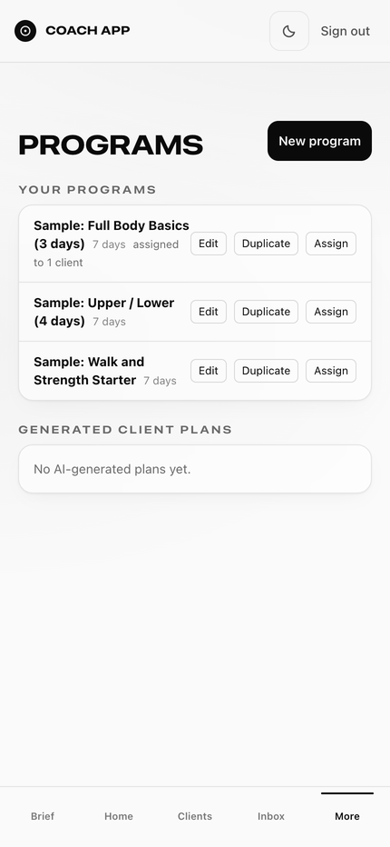

**Edit** opens the program builder. Each exercise has a **demo URL** box where you can paste a link
to your own demo video. The samples have none.

## 2. Add your first client

1. Tap **Clients** in the bottom bar, then **Add client**.
2. Type their **Name** and **Email**. Leave **Tier**, **Status** and **Client type** as they are
   for now.
3. Tap **Create client**.

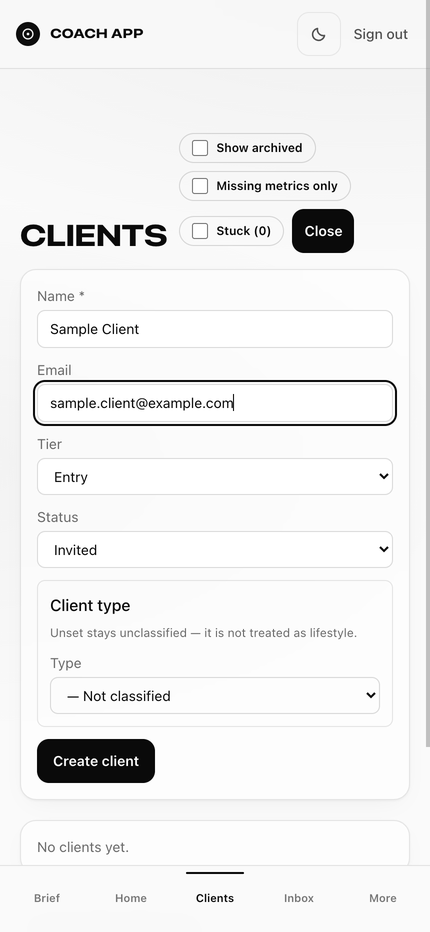

The app opens the new client. At the top is a checklist of what has to be true before the client
can see anything:

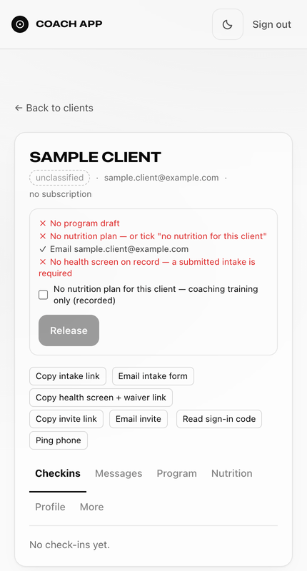

Nothing reaches the client until every line has a tick and you tap **Release**. The next steps
fill in the red lines.

Back on the **Clients** list, a box called **Classify clients** asks whether each client is
**Lifestyle** or **Prep** (preparing for a show). Tap **Lifestyle** unless they compete. The red
**missing** badge counts body measurements (age, height, weight and so on) that are not on file
yet. They fill in from the client's intake, or you can type them on the client's **Profile** tab.
Neither blocks Release.

## 3. Send the health screen

The app will not release a client without a health screen on file.

1. On the client, tap **Copy health screen + waiver link**. The button changes to
   **Screen + waiver link copied**.
2. Paste the link into a text or email to the client and send it yourself.

The client opens it on their phone. They do not need to sign in. They answer eight yes-or-no
questions, then sign six short documents with one tap:

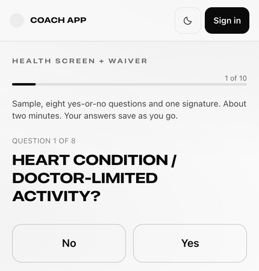
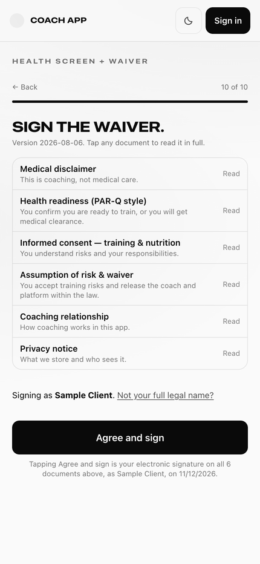

The waiver and health screen text is a starting point, not legal advice. Have it reviewed for
where you coach before you use it with real clients (see "What is not included" in the README).

When all answers are **No**, your checklist line turns into **Health screen clear**. If any
answer is **Yes**, the line reads **Health screen flagged** and **Release** stays off. Speak with
the client before you go further. This guide does not cover clearing a flagged screen.

(**Copy intake link** is a longer form: goal, equipment, training days, experience, body
measurements, food allergies, plus the same health questions and a signature. It also counts as
the health screen, and the measurements appear on the client's **Profile** for you to confirm.)

## 4. Assign a program

1. Tap **More > Programs**.
2. Under the program you want, tap **Assign**.
3. Tick the client and tap **Assign to 1 client**.

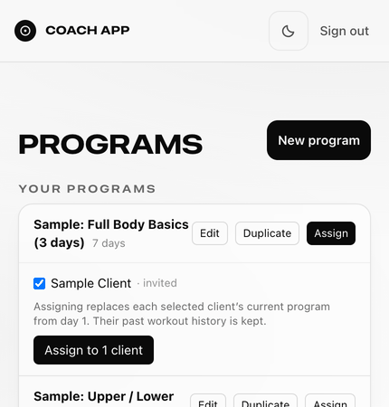

The client's checklist now says **Program live**. Assigning a different program later replaces it
from day 1 and keeps their workout history.

## 5. Decide on nutrition

The checklist needs one of these:

- **No meal plan.** On the client, tick **No nutrition plan for this client**. That is enough.
- **A meal plan.** Use the client's **Nutrition** tab. Its generator needs the client's sex, age,
  height, weight and activity level on their **Profile** first. Or load the sample plan with
  `sample_meal_plan.sql` (see [starter-content/README.md](starter-content/README.md)). It
  arrives as a draft, and the client cannot see a draft.

Before you release, open **Nutrition > Edit / re-assign** and change the plan to fit the client,
then tap **Save draft**:

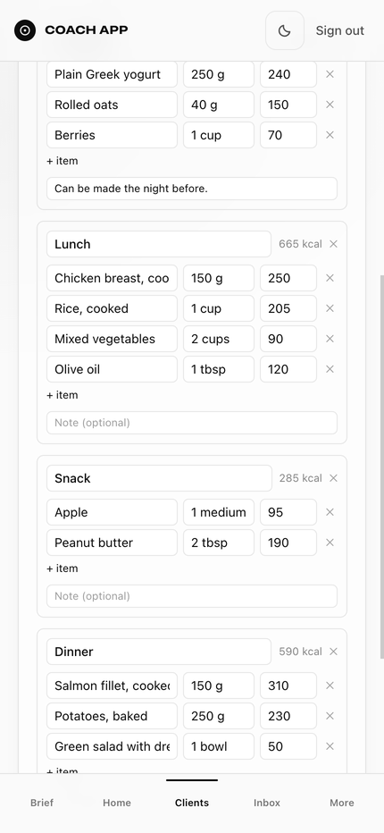

**Release sends whatever draft is there.** If you skip the edit, the client sees the sample plan as
it is, including its note "Sample content, edit before use."

## 6. Release and invite

When every line has a tick, **Release** turns dark:

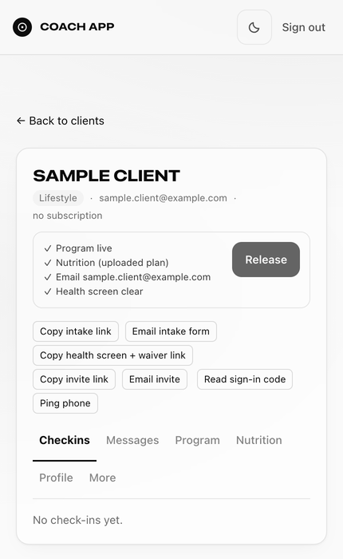

1. Tap **Release**. The app confirms what was released and offers **Copy invite link**. If your
   phone or computer has a mail app, it also opens a message with the invite in it. Press send
   there, or close it and use the link.
2. Send the invite link to the client (text or email).

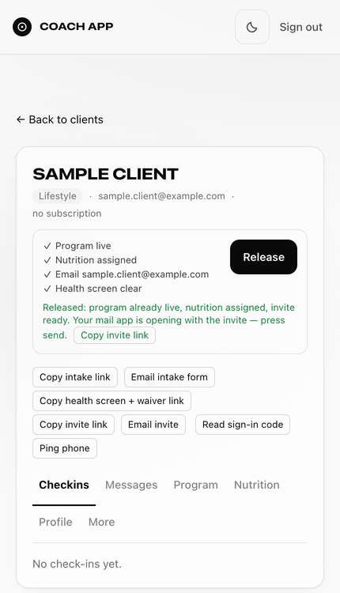

The client opens the link, types their email, and taps **Send sign-in code**. Supabase emails them
a code. They type it and tap **Claim my account**, then **Open the app**.

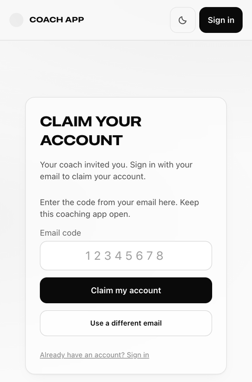

**No email sender yet** (SETUP.md step 27)? Supabase's built-in sender only emails your own team, so
the client gets no code. Tap **Read sign-in code** on the client instead and read them the number
on the phone. They type it in the **Email code** box, or open your site's sign-in page, type their
email, tap **I already have a code** and type it there.

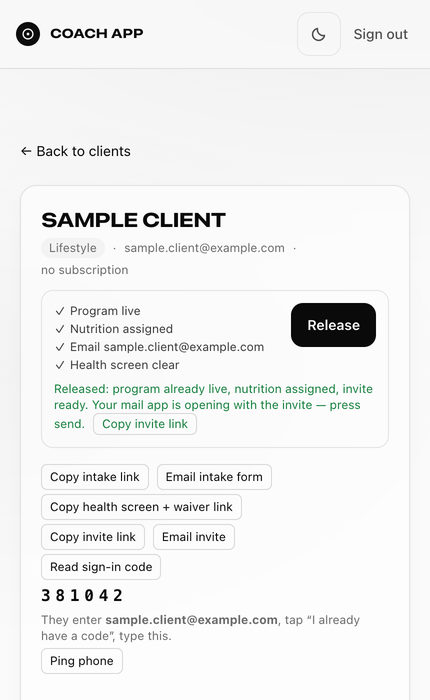

## 7. What the client sees

The first time, the client sees a short briefing and instructions for adding the app to their
Home Screen. Then **Continue to my program** opens **Train**, with today's workout on top:

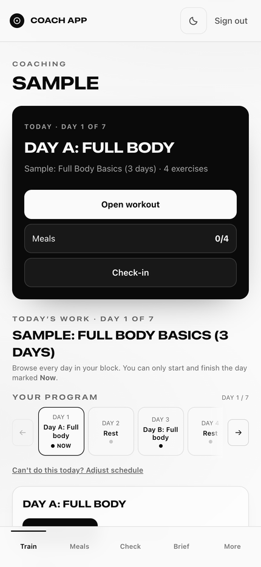

- **Train**: today's workout. **Start workout** walks through each set; they enter weight and
  reps and tap **Mark**, then **Finish workout**. **Ask coach for substitute** sends you a request
  to swap an exercise.
- **Meals**: the meal plan, if you released one. They mark each meal **Logged**, **Skipped** or
  **Backup**.
- **Check**: the check-in form.
- **Brief**: your video and slides (set them on your own **Brief** tab).
- **More**: messages, progress, resources and the rest.

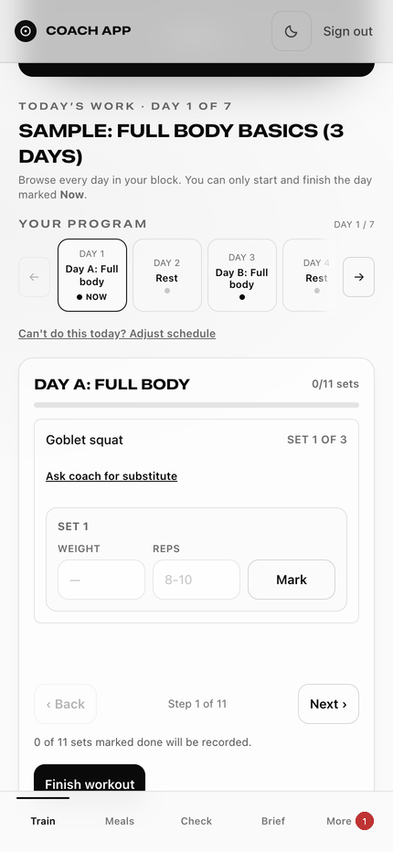
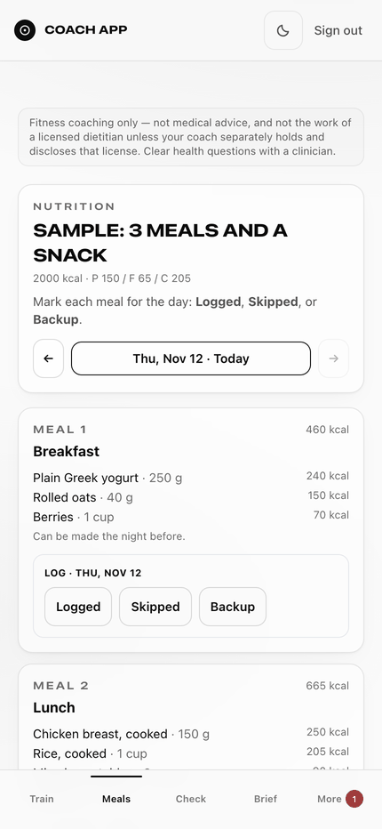

## 8. Check-ins and replies

You do not send a check-in. Every client has the **Check** tab, and the **Check-in** button on
their Train page, from day one. They fill it in when you ask them to, for example every Sunday.
Out of the box the form asks for body weight and "How did the week go?":

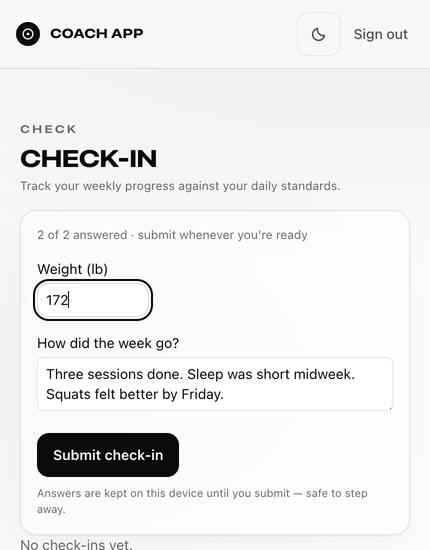

To see it, open the client. The **Checkins** tab shows each one. Tap **Mark seen** when you have
read it:

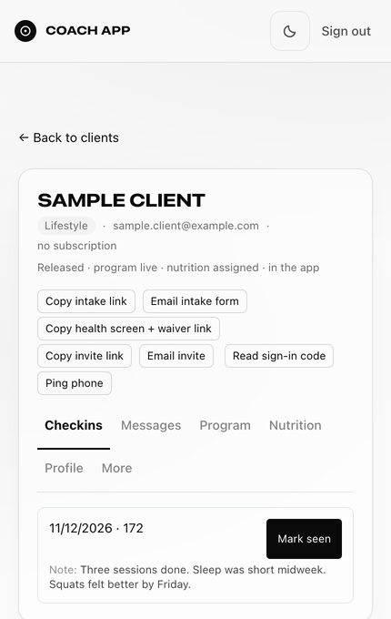

To answer, use the **Messages** tab on the same client (or **Inbox** in the bottom bar). The
client reads it under **More > Messages**:

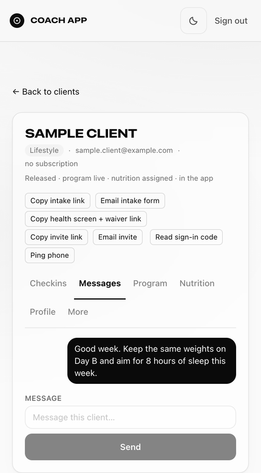
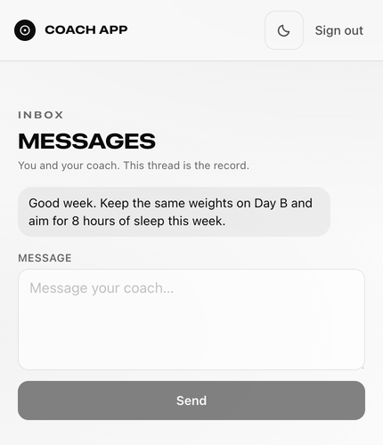

The check-in rhythm is weekly by default. There is no screen in the app to change the rhythm or
the questions yet. The AI connector (SETUP.md, Optional extras) has a tool that sets one
client's rhythm (weekly, every two weeks or monthly).

---

## Things that look wrong but are not

- **Home says "Signal integrity: not configured" or "unavailable" in red.** With no clients, or one
  or two new ones, there is not enough activity to rank anyone yet. It settles once clients train
  and check in.
- **"5 missing" next to a client.** Body measurements are not on file yet. It does not block
  anything.
- **"Push is not configured on this site yet"** under **Settings > Notifications**. Push alerts
  are an optional extra (SETUP.md, Optional extras). Everything else works without them.
- **Settings > Billing**, **Settings > Add coach** and the **Buyers** box on the Clients page belong
  to the optional paid features (Stripe, coaches under your app). You can ignore them.

## Next

- **More > Settings**: your app name, logo, brand color, welcome message and the switches for
  messaging, weight tracking and progress photos. Tap **Save settings** when you are done.
- [COSTS.md](COSTS.md): what the free plans cover and when they would start to cost money.
